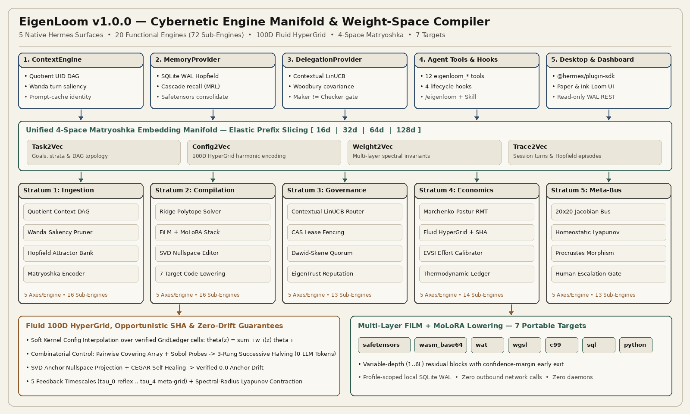

# EigenLoom (`v1.0.0`)

**Self-Adapting Cybernetic Engine Manifold, Fluid 100D Matryoshka HyperGrid, and 7-Target Weight-Space Compiler for Hermes Agent (`>=0.23.0`)**



`eigenloom` unifies five native Hermes Agent extension surfaces around a shared mathematical substrate: **20 continuously improving functional engines** (`72` sub-engines across `5` strata), a **4-space Matryoshka embedding geometry** (`Task2Vec`, `Config2Vec`, `Weight2Vec`, `Trace2Vec` at `16d / 32d / 64d / 128d`), a **100-dimension Fluid HyperGrid** with zero-token **Successive Halving** exploration, and a **multi-layer `FiLM` + `MoLoRA` weight-space compiler** targeting seven portable runtimes.

Everything executes **100% locally in-process** over profile-scoped SQLite WAL storage and dual-mode linear algebra (pure Python standard library out of the box, with automatic NumPy acceleration when present). `eigenloom` makes **zero outbound network calls**, spawns **zero background TCP daemons**, requires **zero API keys**, and ships **zero binary blobs** in source control.

---

## Five Native Hermes Surfaces in One Package

| Surface | Registration API | Core Capabilities |
| :--- | :--- | :--- |
| **1. `ContextEngine`** | `ctx.register_context_engine` | Content-addressed message-UID quotient DAG, Wanda token/turn saliency pruning, exact `request_messages` reference preservation for 100% prompt-cache hits when within budget, thread-safe `clone_for_agent()`, and `eigenloom_context_grep`. |
| **2. `MemoryProvider`** | `ctx.register_memory_provider` | Profile-scoped SQLite WAL continuous Hopfield attractor bank, progressive `16d -> 32d -> 64d -> 128d` Matryoshka recall, automatic write suppression in `cron` / `subagent` / `flush` contexts, and pre-compaction `.safetensors` micro-cartridge consolidation. |
| **3. `DelegationProvider`** | `ctx.register_delegation_provider` | Adds `engine_stratum`, `verification_role` (`maker` / `checker`), and `maker_id` task routing parameters; scores candidate tiers via `Task2Vec × Config2Vec` bilinear `LinUCB` (`Recursive Woodbury` $A^{-1}$) and enforces `maker != checker` via `DelegationRouteError`. |
| **4. Tools, Hooks, Command & Skill** | `register_tool` / `register_hook` / `register_command` / `register_skill` | **12 `eigenloom_*` agent tools**, **4 lifecycle hooks** (`on_session_start`, `pre_tool_call`, `post_tool_call`, `on_session_end`), `/eigenloom [status\|step]` slash command, and bundled `eigenloom-cybernetics` workflow skill. |
| **5. Desktop & Web Dashboard** | `desktop/plugin.js` + `dashboard/` | Native Hermes Desktop inspector pane, status-bar chip, and settings page built strictly on `@hermes/plugin-sdk` + `react/jsx-runtime` (`#f5f2ea` Paper & `#141413` Ink light palette), paired with read-only SQLite WAL FastAPI telemetry routes (`/status`, `/engines`). |

---

## Core Mathematical Subsystems

### 1. Unified 4-Space Matryoshka Embedding Manifold (`16d / 32d / 64d / 128d`)
Every entity in `eigenloom` is projected into one aligned nested representation where each prefix slice is independently L2-normalized onto the unit hypersphere:
- **`Task2Vec`**: encodes goal structure, stratum affinity, verification role, and DAG fanout.
- **`Config2Vec`**: encodes up to `100` continuous, integer, boolean, and categorical `HyperGrid` axes via normalized Fourier harmonic projections.
- **`Weight2Vec`**: encodes single or multi-layer operator stacks via Procrustes-invariant singular spectrum ratios, Shannon effective rank, and row-energy distributions.
- **`Trace2Vec`**: encodes session turns and Hopfield episodic memories for progressive coarse-to-fine cascade retrieval.

### 2. Fluid 100D `HyperGrid` & Opportunistic `Successive Halving` Exploration
Rather than snapping rigidly to a single static configuration preset:
- **Soft Kernel Interpolation**: given any Matryoshka query vector $z$, `FluidHyperGrid` computes kernel weights $w_i(z) = \text{softmax}_i(\langle z_{:d}, \text{Config2Vec}(\theta_i)_{:d}\rangle / \tau)$ **strictly over `verified` and `promoted` `GridLedger` cells**, synthesizing a continuous clamped configuration $\theta(z) = \sum_i w_i(z)\theta_i$.
- **Taming Combinatorial Explosion at `0` Extra LLM Tokens**: across `100` tunable dimensions (`5` axes × `20` engines), `eigenloom` combines logarithmic **Strength-2 Pairwise Covering Arrays** with low-discrepancy **Van der Corput / Sobol + Uniform random probes** scaled elastically by `compute_headroom_ratio`. Candidates are filtered through **3-rung `Successive Halving`** (`16d` bilinear Woodbury surrogate -> `64d` cached `maker != checker` replay -> `128d` full verification) without invoking any external model calls.
- **Boundary Auto-Expansion**: when verified optima saturate an expandable `ParameterBounds` edge, `eigenloom` automatically expands that axis into a new `NodeGrid` generation.

### 3. Multi-Layer `FiLM` + `MoLoRA` Cartridge Compiler (7 Portable Targets)
`eigenloom_compile_cartridge` fits regularized Ridge polytopes and SVD specialist factors into a variable-depth (`1..6` layers) residual operator stack featuring:
- **`MoLoRA` (Mixture of Low-Rank Adapters)**: soft-gated low-rank specialist branches conditioned on `Matryoshka` context vectors.
- **`FiLM` (Feature-wise Linear Modulation)**: per-layer affine scale/shift modulation $\gamma_\ell(z) \odot h_\ell + \beta_\ell(z)$.
- **Confidence-Margin Early Exit**: halts execution at layer $\ell < L$ as soon as top-2 probability margin exceeds the fluid threshold.
- **7 Zero-Dependency Targets**:
  1. `safetensors` (IEEE-754 float32 tensors + `Weight2Vec` metadata header)
  2. `wasm_base64` (spec-compliant WebAssembly 1.0 binary synthesized dynamically in memory — zero `.wasm` files written to disk)
  3. `wat` (human-auditable WebAssembly Text format)
  4. `wgsl` (WebGPU `@compute` shader kernel)
  5. `c99` (self-contained ANSI C99 inference source)
  6. `sql` (pure ANSI SQL CTE relational matrix-vector evaluator)
  7. `python` (zero-dependency standalone Python callable module)

### 4. Zero-Anchor-Drift Surgical Weight Editing & `CEGAR` Self-Healing
`eigenloom_surgical_edit` supports `svd_nullspace`, `lora_xs`, `recursive_woodbury`, `procrustes_align`, and `hopfield_write`. Updates are projected onto the exact orthogonal complement $P_\perp = I - V_a V_a^\top$ of protected anchor subspaces, with **Counterexample-Guided Abstraction Refinement (`CEGAR`)** automatically folding any drifting counterexample probe into the protected basis to guarantee **`0.0` anchor drift**.

---

## The 20 Continuously Improving Functional Engines (`72` Sub-Engines)

| # | Engine ID | Stratum | Primary Timescale | Sub-Engines |
| :--- | :--- | :--- | :--- | :---: |
| 0 | `quotient_context_dag_engine` | `ingestion_and_memory` | `tau_0_reflex` | 4 |
| 1 | `wanda_saliency_pruning_engine` | `ingestion_and_memory` | `tau_0_reflex` | 4 |
| 2 | `hopfield_attractor_memory_engine` | `ingestion_and_memory` | `tau_2_consolidation` | 4 |
| 3 | `matryoshka_manifold_encoder_engine` | `ingestion_and_memory` | `tau_0_reflex` | 4 |
| 4 | `ridge_polytope_compiler_engine` | `compilation_and_lowering` | `tau_2_consolidation` | 4 |
| 5 | `multilayer_film_molora_stack_engine` | `compilation_and_lowering` | `tau_1_episode` | 4 |
| 6 | `svd_nullspace_surgical_editor_engine` | `compilation_and_lowering` | `tau_1_episode` | 4 |
| 7 | `portable_target_lowering_engine` | `compilation_and_lowering` | `tau_2_consolidation` | 4 |
| 8 | `contextual_linucb_router_engine` | `routing_and_governance` | `tau_1_episode` | 4 |
| 9 | `cas_fission_lease_fencing_engine` | `routing_and_governance` | `tau_0_reflex` | 3 |
| 10 | `dawid_skene_quorum_adjudicator_engine` | `routing_and_governance` | `tau_1_episode` | 3 |
| 11 | `eigentrust_reputation_flow_engine` | `routing_and_governance` | `tau_2_consolidation` | 3 |
| 12 | `rmt_marchenko_pastur_spectral_engine` | `adaptation_and_economics` | `tau_2_consolidation` | 4 |
| 13 | `fluid_hypergrid_interpolator_engine` | `adaptation_and_economics` | `tau_0_reflex` | 4 |
| 14 | `evsi_effort_cascade_calibrator_engine` | `adaptation_and_economics` | `tau_0_reflex` | 3 |
| 15 | `operation_cost_thermodynamic_engine` | `adaptation_and_economics` | `tau_1_episode` | 3 |
| 16 | `inter_engine_coupling_and_jacobian_bus` | `meta_cybernetic_coupling` | `tau_3_morphism` | 4 |
| 17 | `homeostatic_meta_controller_engine` | `meta_cybernetic_coupling` | `tau_4_meta_grid` | 3 |
| 18 | `structural_morphism_and_transfer_engine` | `meta_cybernetic_coupling` | `tau_3_morphism` | 3 |
| 19 | `human_attention_and_escalation_engine` | `meta_cybernetic_coupling` | `tau_1_episode` | 3 |

---

## Agent Tool Suite (12 Tools)

1. `eigenloom_fission_dag` — Decompose composite goals into content-addressed SQLite WAL DAG subtasks with interface contracts and minimum-entropy disambiguation questions.
2. `eigenloom_claim_and_fence` — Acquire atomic compare-and-swap task leases (`fencing_stamp` + monotonic `fencing_version`) or return verified cache hits.
3. `eigenloom_verify_record` — Record independent `maker != checker` verifications and trigger simultaneous `Recursive Woodbury`, `Dawid-Skene`, and `EigenTrust` updates.
4. `eigenloom_compile_cartridge` — Compile symbolic rules or verified traces into multi-layer `FiLM` + `MoLoRA` cartridges across all 7 portable targets.
5. `eigenloom_analyze_spectrum` — Run Marchenko-Pastur RMT noise-edge, Roy-Vetterli effective rank, power-law tail exponent, and Wanda input-saliency diagnostics.
6. `eigenloom_surgical_edit` — Apply zero-anchor-drift weight edits (`svd_nullspace`, `lora_xs`, `recursive_woodbury`, `procrustes_align`, `hopfield_write`) with `CEGAR` refinement.
7. `eigenloom_coupling_step` — Advance multi-timescale ($\tau_0 \dots \tau_4$) Jacobian coupling under Lyapunov contraction bounds and run opportunistic `Successive Halving`.
8. `eigenloom_morphism_transfer` — Detect Laplacian spectral DAG isomorphisms and transplant cartridges across domains via Orthogonal Procrustes alignment.
9. `eigenloom_calibrate_effort` — Compute Expected Value of Sample Information (`EVSI`) to select reasoning effort, `Matryoshka` slice depth, and escalation thresholds.
10. `eigenloom_manifold_status` — Return full 20-engine / 72-sub-engine `GridLedger`, `OperationCostLedger`, and fluid configuration telemetry.
11. `eigenloom_context_grep` — Hybrid lexical + `Trace2Vec` semantic search over the session message-UID quotient DAG.
12. `eigenloom_attractor_recall` — Progressive `Matryoshka` cascade retrieval over the SQLite WAL Hopfield episodic memory bank.

---

## Measured Benchmarks

Measured on Linux x86_64 across both **NumPy-accelerated** (`Python 3.14.4`) and **pure Python standard-library** (`Python 3.11.15`, `python_dependencies: []`) runtimes:

| Benchmark Operation | NumPy Accelerated | Pure Python Stdlib | Key Invariant / Savings |
| :--- | :---: | :---: | :--- |
| **Boot 20 Engines + 100D `HyperGrid`** | `64.1 ms` | `149.8 ms` | 60 verified seed cells indexed in `BilinearWoodburySurrogate` |
| **Matryoshka `16d->32d->64d->128d` Cascade (128 items)** | `2.00 ms` | `21.35 ms` | **`68.8%` MAC reduction** vs. exhaustive `128d` scan |
| **3-Rung `Successive Halving` (`36 -> 12 -> 4` probes)** | `84.2 ms` | `263.5 ms` | **`0` extra LLM tokens** (replays verified WAL records) |
| **SVD Nullspace + `CEGAR` Edit Across All 20 Engines** | `2.75 ms` | `10.92 ms` | **`0.0` maximum anchor drift** across all 20 engines |
| **Compile 5-Layer `FiLM`+`MoLoRA` Stack & Lower All 7 Targets** | `3.01 ms` | `12.43 ms` | **`80.0%` layer savings** (`1/5` layers) on high-margin early exit |

---

## Installation & Activation

Install directly via the Hermes plugin manager:

```text
hermes plugins install eigenloom
```

Optional provider selection keys in your Hermes profile settings:
- Context Engine: `context.engine: eigenloom`
- Memory Provider: `memory.provider: eigenloom`
- Delegation Provider: `delegation.provider: eigenloom`

Plugin settings (`config_schema`):
- `compute_headroom_ratio` (`float`, default `0.6`): fraction of spare local CPU budget allocated to zero-token `Successive Halving` `HyperGrid` exploration.
- `default_matryoshka_dim` (`int`, default `64`): default nested `Matryoshka` prefix dimension (`16`, `32`, `64`, or `128`).
- `enable_idle_exploration` (`bool`, default `true`): run opportunistic configuration exploration during `on_session_end`.

---

## Security, Privacy & Isolation Disclosure

- **Zero Network Egress**: `eigenloom` performs zero HTTP, WebSocket, DNS, or raw socket calls.
- **Zero Background Daemons**: all operations execute synchronously in-process; dashboard telemetry reads local SQLite WAL files in read-only mode (`mode=ro`).
- **Zero External Secrets**: requires zero API keys (`requires_env: []`) and never reads environment variables directly.
- **Zero Binary Blobs in Source Control**: WebAssembly modules (`wasm_base64`) and `.safetensors` buffers are synthesized deterministically in memory on demand.
- **Public API Boundary**: imports exclusively whitelisted Hermes public extension interfaces (`agent.context_engine`, `agent.memory_provider`, `agent.delegation_provider`, `hermes_constants`, `plugins.plugin_storage`) with standalone ABC fallbacks.

## License

MIT License — Copyright (c) 2026 `aidonerightcorp`.
